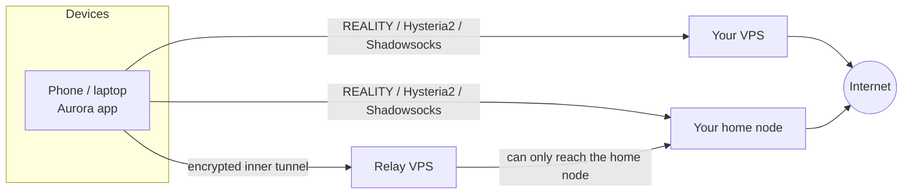

# Aurora

**Your own multi-protocol VPN. One command on your server, one scan on your phone.**

Aurora connects your devices to servers **you** own: a cheap VPS, or a machine at home. It runs several
protocols behind one address and fails over between them automatically, so a network that blocks one still
leaves you connected. There is no account, no subscription and no telemetry.

```bash
curl -fsSL https://raw.githubusercontent.com/SparkyWen/aurora-public/main/install.sh | sudo bash
```

That is the whole server setup. The command works out whether it is on a VPS or behind a home router,
generates fresh keys, opens the firewall, **proves real traffic flows** through every protocol, and prints a
link and QR code for the app.

## Why another VPN?

A single tunnel, such as plain WireGuard, is easy to identify and block, and when it goes down you lose the
connection entirely. Aurora doesn't bet on one protocol:

| Protocol | Port (VPS) | Good at |
| --- | --- | --- |
| VLESS + Vision + REALITY | TCP 443 | Looks like real TLS to a real website; hard to fingerprint |
| Hysteria2 | UDP 443 | Fast on lossy links, QUIC-based, hops source ports to dodge per-flow throttling |
| Shadowsocks 2022 | TCP 8443 | Lightweight fallback |

The client tests them continuously and moves to whichever works, with no action from you.

## Quick start

**1. Set up a server.** On a Linux or macOS machine you control:

```bash
curl -fsSL https://raw.githubusercontent.com/SparkyWen/aurora-public/main/install.sh | sudo bash
```

**2. Install the app.** [Download a release](https://github.com/SparkyWen/aurora-public/releases) for Android,
Windows or Linux, or [build from source](docs/building.md). iOS and macOS must be built with your own Apple
developer account, because Apple only grants the VPN entitlement per developer.

**3. Add your server.** On a phone, scan the QR code with your camera. On a desktop, click **Add a server** and
paste the `aurora://` link. Then press **Connect**.

## Choose your setup

| You have | Run | Traffic exits from |
| --- | --- | --- |
| A VPS | `install.sh` | The VPS |
| A machine at home | `install.sh --home` | Your home IP |
| A home machine, and a VPS for reachability | `install.sh --home` at home, then `install.sh relay '<link>'` on the VPS | Your home IP, reached through the VPS |
| A server whose IP gets blocked | Add `--cdn-domain cdn.example.com` | Your server, reached through Cloudflare |

Add as many servers as you like. Each appears as its own route in the app, and you can lock onto one or leave
it on automatic. The [self-hosting guide](docs/self-hosting.md) covers home networks, dynamic DNS, carrier-grade
NAT, relays and CDN fronting.



## Managing a node

```bash
sudo aurora-node link        # print the import link and QR code again
sudo aurora-node status      # service state, address, ports
sudo aurora-node verify      # re-run the end-to-end traffic test
sudo aurora-node rotate      # replace all keys (clients re-import the new link)
sudo aurora-node uninstall   # remove it (--purge also deletes the keys)
```

Re-running the installer is always safe. It keeps your keys, so connected clients keep working.

## Features

- **Automatic failover** between protocols, driven by real data-path health checks rather than latency alone
- **Bring your own servers**: any number of VPS and home nodes, merged into one route list
- **Smart and Global modes**: Smart sends mainland China domains and IPs directly and proxies the rest, with
  split DNS; Global proxies everything except a short allowlist
- **Relay chaining** that keeps your home IP as the exit, with a relay that can only forward to your home node
- **CDN fronting** that survives a block of your server's IP
- **Leak protection**: IPv6 blocked by default, and kill-switch behaviour on supported platforms
- **Android, iOS, macOS, Windows and Linux**, plus a headless CLI for servers
- **No telemetry**: no analytics, no crash reporting, no accounts. Nothing reports to anyone

## Platforms

| Platform | Install | Core |
| --- | --- | --- |
| Android 7+ | APK from Releases | libbox via `VpnService` |
| iOS 15+ | [Build from source](docs/building.md#ios) | libbox via `NEPacketTunnelProvider` |
| macOS 12+ | [Build from source](docs/building.md#macos) | libbox via a system extension |
| Windows 10+ | Installer from Releases | `aurora-svc` service + official sing-box + Wintun |
| Linux (systemd) | `.deb` or `.tar.gz` from Releases | `aurora-svc` service + official sing-box |
| Headless Linux | Included: `aurora import '<link>' && aurora connect` | Same service |

Node installer: Linux with systemd (x86-64, ARM64, ARMv7) and macOS. The GUI on Linux is compile-checked but has
had less real-world use than the other platforms; reports are welcome.

## Documentation

- [Self-hosting guide](docs/self-hosting.md): VPS, home nodes, relays, CDN, dynamic DNS, troubleshooting
- [Architecture](docs/architecture.md): how the pieces fit
- [Contract and link format](docs/contract.md): the `aurora://` link and contract schema
- [Building from source](docs/building.md): every platform, including signing
- [Reliability notes](docs/reliability-notes.md): failure modes and how to diagnose them
- [Control plane](control-plane/README.md): optional, push config updates over Cloudflare Workers
- [Signed egress](docs/advanced-signed-egress.md): optional hardening for advanced setups
- [Security](SECURITY.md) and [Contributing](CONTRIBUTING.md)

## Responsible use

Aurora is a tool for reaching your own servers and protecting your own traffic. You are responsible for following
the laws of where you are, and the terms of your hosting provider and ISP. It does not make you anonymous; see
[SECURITY.md](SECURITY.md) for what it does and does not protect.

## License

[GPL-3.0-or-later](LICENSE). Aurora links [sing-box](https://github.com/SagerNet/sing-box), which is licensed under
GPL-3.0-or-later with an additional clause on the use of its name. Aurora is an independent project, not affiliated
with or endorsed by sing-box.
