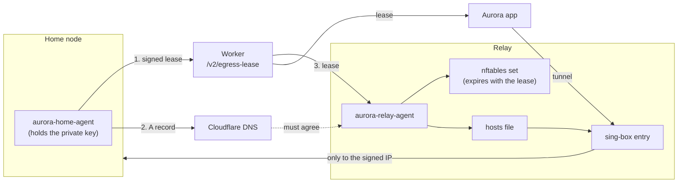

# Signed egress leases

**This is an advanced option that you wire up by hand. `install.sh` does not set it up, and no command
enables it.** Most people do not need it: `install.sh` on a home node plus `install.sh relay` on a VPS
already gives you a relay that can only forward to your home node.

What has and has not been tested:

- The agents, the Worker routes and the app's lease and path logic are covered by automated tests.
- The service templates in `deploy/advanced/signed-egress/` come from a deployment that ran in production,
  rewritten with generic paths and pointed at the `aurora-node` service.
- **That combination, the templates on top of an `install.sh` relay, has not been run end to end.** Treat
  the steps below as a careful starting point, and verify the exit yourself when you are done.

## What a lease is

A lease is a short statement signed by the home node: "my name is X, my public IPv4 is Y, until time Z."

```json
{
  "version": 1,
  "key_id": "home-egress-1",
  "home_name": "home.example.net",
  "ipv4": "203.0.113.9",
  "sequence": 1784424373200,
  "issued_at": "2026-07-22T00:00:00Z",
  "expires_at": "2026-07-22T02:00:00Z",
  "signature": "<base64 Ed25519 signature>"
}
```

The signature covers the canonical JSON of the other fields (sorted keys, no whitespace). The private key
stays on the home machine. `sequence` only ever rises, and a lease is valid for at most 125 minutes.

## Why you might want one

A relay usually finds a home node through a dynamic DNS name, because home IPs change. That means whoever
controls the answer to that name decides where the relay forwards traffic: a leaked DNS API token, a
compromised DNS account, or a poisoned resolver. Your tunnel keeps working and keeps looking healthy, so
nothing tells you.

With leases:

- **The relay moves only to an address the home node signed.** DNS must also agree, but DNS alone can never
  move it. A DNS attacker gets a `dns_lease_mismatch` in the relay's log, and traffic stays where it was.
- **The app checks independently.** It verifies the lease itself and compares it with the address its traffic
  really exits from. If a path exits anywhere else, the app blocks traffic rather than letting it leave from
  the wrong place.
- **It fails closed.** If the home agent stops signing, the relay's firewall entry times out when the lease
  expires, and the path closes. It does not keep forwarding to a stale address.
- **The control plane is not trusted.** The Worker only stores leases. It holds no signing key and cannot
  forge one. A stolen write token can only overwrite the stored lease with something that fails verification,
  which is a denial of service, not a redirect.

What it does not do:

- It does not protect you if the home machine itself is compromised: that is where the key lives.
- It does not hide your home IP from your Cloudflare account. The lease states it in plain text.
- It does not make a blocked relay reachable. Reachability is what the multiple entries are for.

You probably want this if a redirected relay would really hurt you and you are comfortable running two more
daemons and editing a sing-box config by hand. Otherwise, skip it.

## Building blocks

| Piece | Where | What it does |
| --- | --- | --- |
| `aurora-home-agent` | `edge-agent/cmd/aurora-home-agent`, home node | Finds the public IP, signs and publishes the lease, keeps a Cloudflare DNS record in step |
| Worker lease store | `control-plane/`, `GET`/`PUT /v2/egress-lease` | Stores the newest lease in a Durable Object, rejects replays. Separate read and write tokens |
| `aurora-relay-agent` | `edge-agent/cmd/aurora-relay-agent`, relay | Verifies each lease, then updates an nftables set and a hosts file |
| Service templates | `deploy/advanced/signed-egress/` | systemd units, launchd plist, and the relay's nftables boundary |
| Contract fields | `paths`, `path_policy`, `egress` | Declare the paths, the failover policy and the lease identity ([`contract.md`](contract.md)) |
| `EgressLeaseVerifier`, `EgressLeaseRepository`, `ConnectionLeaseBootstrap` | `app/lib/` | Fetch and verify leases in the app, and keep the last valid one in secure storage |
| `PathHealthCoordinator` | `app/lib/app/path_health_coordinator.dart` | Measures each path, picks one, and blocks traffic when no path can be verified |
| `scripts/verify-path-egress.sh` | Your machine | Pins each path in turn and proves it exits at the leased address |

## How they fit together



1. Every `poll_seconds`, the home agent asks two HTTPS reflectors for its public IP. If they disagree or fail,
   it publishes nothing.
2. When the IP changes, or `refresh_seconds` have passed, it signs a new lease and `PUT`s it with the write
   token. It publishes the lease **before** updating DNS, so a relay never sees a new DNS answer it cannot
   yet back with a signature. Then it updates the DNS-only A record.
3. The Worker checks the envelope, the timestamps and that `sequence` rises, and stores the lease verbatim.
   A single Durable Object serializes this, so two concurrent writers cannot both win.
4. Every `poll_seconds`, the relay agent fetches the lease and verifies the signature, key id, name, sequence
   and expiry. It then requires DNS to include the signed address. Only then does it check and apply an
   nftables transaction that holds that one address, with a timeout equal to the lease's remaining life, and
   update the hosts file.
5. A change to the hosts file triggers `aurora-relay-hosts.path`, which restarts the entry. The entry resolves
   the home name only through that file, never through public DNS.
6. On connecting, the app fetches a lease before the tunnel comes up, because the tunnel would otherwise block
   its own first request. A contract with `paths` always compiles in strict Global mode, whatever mode was
   saved, because split routing would bypass the paths. Each new session starts blocked.
   `PathHealthCoordinator` releases a path only after an egress probe matches the lease, and keeps
   re-checking every 30 seconds while connected.

### When something goes wrong

| What happens | Result |
| --- | --- |
| Home agent stops, or the home node goes offline | The relay's nftables entry times out when the lease expires. The app's lease expires too, and it moves to another path or blocks |
| Home IP changes | New lease first, then DNS. The relay applies it once DNS agrees, usually within the DNS TTL plus one poll |
| DNS is hijacked | The relay reports `dns_lease_mismatch` and changes nothing. A lease signature cannot be forged from DNS |
| The two reflectors disagree | Nothing is published. The current lease stays valid until it expires |
| The Worker is unreachable | The relay and the app keep using their current lease until it expires. The app also retries while connecting |
| An old lease is replayed | The Worker, the relay and the app all refuse a sequence going backwards |
| A path exits from the wrong address | The app blocks traffic rather than let it leave from the wrong place |
| The firewall is reloaded and the set is lost | The relay agent notices on its next poll and repairs it, without restarting the entry |

## The contract

The three blocks must appear together. A contract with them cannot be merged with `aurora://` links, because
the health policy describes a specific set of nodes, so this contract is written by hand. Add it in the app as
a whole JSON document, or publish it through your [control plane](../control-plane/README.md).

This example follows `app/test/fixtures/path-contract.json`, shortened to one transport. A real setup repeats the
entry and its two exits for each transport (REALITY, Hysteria2, Shadowsocks), so that one blocked transport does
not take a whole path down:

```json
{
  "version": 1,
  "revision": 200,
  "profile": {"name": "Aurora", "default_mode": "global"},
  "network": {"mtu": 1400, "ipv6_mode": "block", "suppress_https_rr": false},
  "delivery": {
    "primary": "https://aurora-cp.YOUR-SUBDOMAIN.workers.dev/v2/contract",
    "fallbacks": [],
    "token": "YOUR_READ_TOKEN"
  },
  "nodes": [
    {"id": "relay-entry-ss", "role": "entry", "protocol": "shadowsocks-2022",
     "server": "198.51.100.8", "port": 8443,
     "params": {"method": "2022-blake3-aes-128-gcm", "password": "PLACEHOLDER"}},

    {"id": "exit-via-relay-public-ss", "role": "exit", "protocol": "shadowsocks-2022",
     "server": "home.example.net", "port": 2053, "detour": "relay-entry-ss",
     "params": {"method": "2022-blake3-aes-128-gcm", "password": "PLACEHOLDER"}},

    {"id": "exit-via-relay-tailnet-ss", "role": "exit", "protocol": "shadowsocks-2022",
     "server": "100.64.0.26", "port": 8388, "detour": "relay-entry-ss",
     "params": {"method": "2022-blake3-aes-128-gcm", "password": "PLACEHOLDER"}},

    {"id": "exit-direct-ss", "role": "backup", "protocol": "shadowsocks-2022",
     "server": "203.0.113.10", "port": 2053,
     "params": {"method": "2022-blake3-aes-128-gcm", "password": "PLACEHOLDER"}}
  ],
  "outbound_group": {
    "selector": {"tag": "proxy", "members": ["auto", "exit-direct-ss"], "default": "auto"},
    "urltest": {"tag": "auto", "members": ["exit-direct-ss"],
                "url": "https://www.gstatic.com/generate_204", "interval": "3m"}
  },
  "paths": {
    "preferred": "relay_public",
    "items": {
      "relay_public": {"group_tag": "relay-public-auto", "members": ["exit-via-relay-public-ss"]},
      "relay_tailnet": {"group_tag": "relay-tailnet-auto", "members": ["exit-via-relay-tailnet-ss"]},
      "home": {"group_tag": "home-auto", "members": ["exit-direct-ss"]}
    }
  },
  "path_policy": {
    "mode": "prefer_relay",
    "fallback": "home",
    "fallback_order": ["relay_tailnet", "home"],
    "health": {
      "rolling_window": 6, "min_success_rate": 0.83,
      "hard_fail_rounds": 2, "performance_fail_rounds": 4,
      "latency_ratio": 3.0, "latency_delta_ms": 600,
      "recovery_success_rounds": 3, "recovery_stable_seconds": 120,
      "flap_window_seconds": 600, "flap_limit": 2, "flap_cooldown_seconds": 900
    }
  },
  "egress": {
    "bootstrap_ipv4": "203.0.113.10",
    "lease_url": "https://aurora-cp.YOUR-SUBDOMAIN.workers.dev/v2/egress-lease",
    "lease_key_id": "home-egress-1",
    "lease_public_key": "<public_key from the keygen metadata file>",
    "home_name": "home.example.net",
    "expected_country": "US",
    "expected_asn": "AS64500"
  }
}
```

`ConfigCompiler` and the publisher's `validatePublishableContract` enforce the shape. The rules that are easy
to trip over:

- **The topology is fixed.** Signed leases need exactly three paths named `relay_public`, `relay_tailnet` and
  `home`, in that order. There is also an older two-path form (`relay`, `home`), but it only targets a tailnet
  address, so it has no use for a lease.
- **The ports are fixed.** Today `ConfigCompiler` requires `relay_public` members to use port **2053** and
  `relay_tailnet` members to use port **8388**, and the publisher mirrors that, so that a contract is never
  published only to fail on every device. The relay agent's own port settings are configurable, but a
  multi-path contract cannot use other values until both of those checks change.
- All `relay_public` and `relay_tailnet` members must be Shadowsocks-2022, chained through distinct `role: entry`
  nodes, and the two paths must use the same entries.
- `relay_public` members must have `server` equal to `egress.home_name`. `relay_tailnet` members must have
  `server` in `100.64.0.0/10`.
- `home` members must have no `detour`, and their `server` must equal `egress.bootstrap_ipv4`. This address is
  only a starting point that the app uses until it has a lease. Because a home IP changes, this path goes stale
  until you publish a new contract, which is why it is the last resort.
- `outbound_group` may only contain `home` members.
- `expected_country` and `expected_asn` are required and format-checked, but nothing compares them at runtime
  today. `ipv4` from the lease is what is checked.

## Wiring it up

All names, addresses and tokens below are placeholders. Replace each one.

### 1. Worker

Deploy your control plane first ([`control-plane/README.md`](../control-plane/README.md)). Then create the lease
write token, and keep a copy for the home agent:

```bash
cd control-plane
openssl rand -hex 32                              # paste this at the prompt below
npx wrangler secret put AURORA_LEASE_WRITE_TOKEN
```

The read token, `AURORA_TOKEN`, is set when you publish.

**That read token also reads the whole contract, node credentials included.** The relay agent needs it, so
anyone who takes over the relay can download your contract. Weigh this before putting one on a machine you
trust less than the rest of your setup.

### 2. Home node

Install the node with `install.sh --home`. Do not pass `--cf-token` or `--duckdns-token`: the home agent owns the
DNS record here, and a second writer would compete with it. The Shadowsocks port has to be 2053, the default for
home nodes (see the fixed ports above).

```bash
make -C edge-agent home    # cross-compile with GOOS= and GOARCH= if needed
sudo install -d -m 0700 /usr/local/etc/aurora /usr/local/var/lib/aurora
sudo install -d -m 0755 /usr/local/libexec
sudo install -m 0755 edge-agent/dist/aurora-home-agent /usr/local/libexec/aurora-home-agent

# Needs absolute paths, and refuses to overwrite an existing key.
sudo /usr/local/libexec/aurora-home-agent keygen \
  --private /usr/local/etc/aurora/home-egress-ed25519.pem \
  --public /usr/local/etc/aurora/home-egress-ed25519.pub.json \
  --key-id home-egress-1
```

**Back up the private key.** The contract and the relay both pin the public key in the `.pub.json` file.

In Cloudflare, create a DNS-only (grey cloud) A record for a dedicated subdomain, note the zone id and record id,
and create an API token scoped to Zone.DNS edit on that zone. Then write
`/usr/local/etc/aurora/home-agent.json`, owned by root with mode 0600 (the agent refuses any other mode):

```json
{
  "home_name": "home.example.net",
  "zone_name": "example.net",
  "cloudflare_zone_id": "YOUR_ZONE_ID",
  "cloudflare_record_id": "YOUR_RECORD_ID",
  "cloudflare_dns_api_token": "YOUR_DNS_API_TOKEN",
  "lease_url": "https://aurora-cp.YOUR-SUBDOMAIN.workers.dev/v2/egress-lease",
  "lease_write_token": "YOUR_LEASE_WRITE_TOKEN",
  "lease_key_id": "home-egress-1",
  "private_key_path": "/usr/local/etc/aurora/home-egress-ed25519.pem",
  "state_path": "/usr/local/var/lib/aurora/state.json",
  "reflectors": ["https://api.ipify.org", "https://ipv4.icanhazip.com"],
  "poll_seconds": 20,
  "refresh_seconds": 300,
  "dns_ttl_seconds": 60
}
```

- `home_name` must be a real subdomain of `zone_name`, not the apex.
- `reflectors` must be exactly two different HTTPS URLs that return a bare IPv4 address. Use IPv4-only hostnames:
  an IPv6 answer counts as a failure. Pick two independent operators, because their agreement is the check.
- `poll_seconds` must be at least 5. `refresh_seconds` must be at least `poll_seconds` and at most 3600, half of
  the two-hour lease.
- `dns_ttl_seconds` must be 30 or 60.

Check the configuration, then run the agent as a service:

```bash
sudo /usr/local/libexec/aurora-home-agent check --config /usr/local/etc/aurora/home-agent.json
```

On macOS, use `deploy/advanced/signed-egress/com.aurora.home-agent.plist`. On Linux, no template ships, but the
unit is short:

```ini
[Unit]
Description=Aurora home agent
Wants=network-online.target
After=network-online.target

[Service]
ExecStart=/usr/local/libexec/aurora-home-agent run --config /usr/local/etc/aurora/home-agent.json
Restart=on-failure
RestartSec=5s

[Install]
WantedBy=multi-user.target
```

Errors are logged as a category, such as `reflector_disagreement` or `lease_publish_failed`. Logs never hold a token
or a whole address.

### 3. Relay

The relay needs Tailscale as well, because `relay_tailnet` targets the home node's tailnet address. The home node
needs a second Shadowsocks-2022 listener on that address at port 8388. `install.sh` does not create that listener.

Install the entry with `install.sh relay '<link from the home node>'`. Then add the agent:

```bash
make -C edge-agent relay    # RELAY_GOARCH=arm64 for ARM servers
sudo install -m 0755 edge-agent/dist/aurora-relay-agent /usr/local/libexec/aurora-relay-agent
sudo groupadd --system aurora-relay
sudo useradd --system --gid aurora-relay --home-dir /nonexistent --no-create-home \
  --shell /usr/sbin/nologin aurora-relay-agent
# The entry reads the hosts file through this group.
sudo usermod --append --groups aurora-relay aurora-node
sudo install -d -m 0750 -o root -g aurora-relay /etc/aurora-relay
```

Write `/etc/aurora-relay/target-agent.json`, owned `root:aurora-relay` with mode 0640:

```json
{
  "home_name": "home.example.net",
  "lease_url": "https://aurora-cp.YOUR-SUBDOMAIN.workers.dev/v2/egress-lease",
  "lease_read_token": "YOUR_READ_TOKEN",
  "lease_key_id": "home-egress-1",
  "lease_public_key_base64": "<public_key from the keygen metadata file>",
  "home_tailnet_address": "100.64.0.26",
  "home_public_port": 2053,
  "home_tailnet_port": 8388,
  "poll_seconds": 15,
  "state_path": "/var/lib/aurora-relay/state.json",
  "hosts_path": "/run/aurora-relay/home-hosts",
  "nft_path": "/run/aurora-relay/home-ip.nft",
  "nft_binary": "/usr/sbin/nft"
}
```

`poll_seconds` must be between 5 and 3600. `nft_binary` must be an absolute path to a file named `nft`, because the
agent runs it with `CAP_NET_ADMIN`. The agent only sanity-checks the two ports; what enforces them is the boundary
and the route rules below, so keep all three in agreement.

Create `/etc/aurora-relay/base.nft` from `deploy/advanced/signed-egress/base.nft.example`, and install the three
units from the same directory. The agent's own table and set names (`inet aurora_relay`, `home_ipv4`) are fixed.

Then change the entry's `/etc/aurora-node/sing-box.json`. **`install.sh` regenerates this file on a re-run or a
rotation, so re-apply your edit afterwards.** Keep the inbounds, and replace `dns`, `outbounds` and `route`:

```json
{
  "dns": {
    "servers": [{"type": "hosts", "tag": "home-hosts", "path": "/run/aurora-relay/home-hosts"}],
    "rules": [{"ip_accept_any": true, "server": "home-hosts"}],
    "final": "home-hosts",
    "strategy": "ipv4_only"
  },
  "outbounds": [
    {"type": "direct", "tag": "home-public", "domain_resolver": "home-hosts"},
    {"type": "direct", "tag": "home-tailnet", "bind_interface": "tailscale0"}
  ],
  "route": {
    "rules": [
      {"network": "tcp", "domain": ["home.example.net"], "port": 2053,
       "action": "route", "outbound": "home-public"},
      {"network": "tcp", "ip_cidr": ["100.64.0.26/32"], "port": 8388,
       "action": "route", "outbound": "home-tailnet"},
      {"action": "reject", "method": "default", "no_drop": true}
    ],
    "final": "home-public",
    "auto_detect_interface": false
  }
}
```

**The boundary changes REALITY's handshake.** `install.sh` points the REALITY handshake at a remote site, and
`base.nft` rejects everything sing-box originates except the home node. So either run a TLS 1.3 site on the relay
and set the inbound's `handshake` to `{"server": "127.0.0.1", "server_port": 443}`, or add a rule to `base.nft` for
your handshake target. Otherwise REALITY stops working while Hysteria2 and Shadowsocks still pass, which is confusing
to debug.

Start things in this order, because the entry must not run before its boundary and its hosts file exist. Starting
the agent loads `base.nft` and runs one full sync before the service counts as started:

```bash
sudo systemctl daemon-reload
sudo systemctl enable --now aurora-relay-agent.service aurora-relay-hosts.path
sudo /usr/local/lib/aurora-node/sing-box check -c /etc/aurora-node/sing-box.json
sudo systemctl restart aurora-node
```

### 4. Publish the contract and verify

Publish the contract, and add the delivery link in the app. Then verify the exit rather than trusting the green
status:

```bash
# On the relay: one address, with a timeout close to the lease's remaining life.
sudo nft list set inet aurora_relay home_ipv4

# Anywhere: pin each exit in a compiled config and check where it really comes out.
cd app && dart run tool/compile_check.dart <contract.json> global ../compiled.json && cd ..
scripts/verify-egress.sh --config compiled.json --expect <your home IP>
```

`scripts/verify-path-egress.sh` goes further: it verifies the lease signature, then proves each path against the
leased address through a running tunnel. Its header explains the setup.

Then try the failure you built this for. Point the DNS record at another address and confirm that the relay logs
`dns_lease_mismatch` and that traffic keeps exiting from home. Stop the home agent and confirm that the path closes
when the lease expires.

## Rotating the lease key

There is no rotation command. Generate a new key on the home node, update `lease_key_id` and
`lease_public_key_base64` on the relay, publish a contract with the new `lease_key_id` and `lease_public_key`, and
point the home agent at the new key last. Expect a gap in the `relay_public` path while the old and new keys are
out of step: the app and the relay refuse a lease signed by the other key, and `relay_tailnet` carries the traffic
in the meantime.
