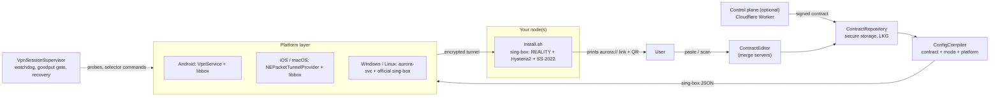

# Architecture

This document explains how Aurora is put together and why. It is written for a new contributor:
read it once end to end, then use the file references as a map. The code is the source of truth;
where a comment and this document disagree, trust the code and fix the document.

Companion documents:

- [`docs/contract.md`](contract.md): the contract schema and the `aurora://` link formats.
- [`docs/self-hosting.md`](self-hosting.md): running `install.sh` on a VPS or at home.
- [`docs/building.md`](building.md): toolchains and per-platform builds.
- [`docs/advanced-signed-egress.md`](advanced-signed-egress.md): multi-path contracts with signed
  egress leases.
- [`docs/reliability-notes.md`](reliability-notes.md): the failure modes behind many of the design
  decisions below. When this document says "see reliability notes", that is where the evidence is.
- [`CONTRIBUTING.md`](../CONTRIBUTING.md): the hard constraints that must not be violated.

## 1. The thesis

A single tunnel protocol is a single point of failure. Networks that interfere with VPN traffic do
it differently per carrier, per hour and per port: one blocks UDP, one throttles each UDP flow,
one resets TCP connections that look like a proxy. Whichever protocol a user picked is the one that
stops working on the day it matters.

Aurora therefore does not bet on one protocol. A node serves several behind one address (REALITY,
Hysteria2, Shadowsocks 2022, optionally VLESS over a CDN), and the client keeps all of them in
play: it measures them, switches between them, and refuses to claim "connected" when no bytes
move. Protocol diversity is necessary but not sufficient. If the address itself is blocked, every
protocol on it dies together, so the design also supports independent entry points (a relay on a
different network, a CDN-fronted path). See the first sections of the reliability notes.

Other principles that shape the code:

- **No telemetry.** There is no analytics, crash reporting or phone-home. Diagnostics stay on the
  device until a user exports them.
- **No bundled servers, no bundled keys.** A fresh install has no contract. Users add their own
  server by importing a link (section 4).
- **Verify the exit, not the connectivity.** A path that works but leaves from the wrong place is
  worse than a dead one, because it looks healthy.
- **Fail loudly and early.** The compiler rejects an inconsistent contract rather than producing a
  config that half-works.

## 2. System overview



Three ideas carry the whole system:

1. **A contract is data.** It lists nodes and how they are grouped, and nothing platform specific.
2. **One compiler turns a contract into sing-box JSON.** It is plain Dart, shared by every
   platform and by the headless CLI. The Go core contains no application logic.
3. **A supervisor judges the data plane.** Platform "connected" only means a tunnel object
   exists. The supervisor sends real traffic through it and acts on what it sees.

## 3. Repository layout

| Path | What lives there |
|---|---|
| `install.sh` | One-file node installer and the `aurora-node` management command (link, status, verify, rotate, maintain, uninstall). Installs a pinned, checksum-verified sing-box. |
| `app/lib/core/` | Pure logic: contract model, `ConfigCompiler`, link parsing, `ContractEditor`, route families, goodput gate, physical network detection, bridges. |
| `app/lib/data/` | Storage and network I/O: `ContractRepository`, `DeliveryService`, `ContractVerifier`, connection probes, secure storage. |
| `app/lib/app/` | Orchestration: `ConnectFlow`, `VpnSessionSupervisor`, `TunnelRecovery`, `DesktopConnectionRecovery`, `PathHealthCoordinator`, path event log. |
| `app/lib/features/` | UI (connect, nodes, servers, settings). |
| `app/lib/cli/`, `app/bin/` | The headless `aurora` command line. Must stay free of Flutter imports. |
| `app/android/`, `app/ios/`, `app/macos/` | Native layers: Kotlin `VpnService`, Swift `PacketTunnel` extensions. |
| `app/windows/`, `app/linux/` | Desktop runners, installer and packaging. |
| `desktop/aurora-svc/` | Go privileged helper for Windows and Linux. |
| `core/` | Go module that pins `sing-box/experimental/libbox` and drives `gomobile bind`. No app logic. |
| `control-plane/` | Optional Cloudflare Worker for contract delivery. |
| `edge-agent/` | Go agents for the advanced signed-egress setup (home and relay). |
| `scripts/` | Verification tools, notably `verify-egress.sh`. |
| `tests/upstream-dns/` | Go regression test against the real sing-box DNS and selector code. |
| `app/test/` | Dart tests; `app/test/fixtures/` holds the golden compiler outputs. |

## 4. The core pipeline

### 4.1 `install.sh` and the `aurora://` link

`install.sh` turns a machine into a node. It installs sing-box at a pinned version after verifying
the archive checksum, generates fresh credentials, serves REALITY, Hysteria2 and Shadowsocks 2022
on one address, opens the local firewall, runs an end-to-end self-test, and prints one
`aurora://v1/...` link plus a QR code. It is idempotent: re-running keeps existing credentials so
connected clients are not kicked.

Placement matters because the default ports differ. A VPS defaults to TCP 443, UDP 443 and TCP
8443. A home node defaults to ports other than 80 and 443, because home ISPs commonly block
inbound 80 and 443, and it adds UPnP port mapping and a maintenance timer that refreshes the
mapping and any dynamic DNS record. A third mode, `relay`, installs an entry-only server bound to
a home node (section 6).

The link is base64url-encoded, gzip-compressed compact JSON (`app/lib/core/server_bundle.dart`). It describes a
**server**, not a contract, so several links can be merged. It has to be small enough for a QR
code on an 80-column terminal. The kinds are:

- `vps`, `home`: terminal exits. Traffic leaves from that machine.
- `relay`: entry only. It carries an `exit` section naming the home node it forwards to.
- `delivery`: points the app at a control plane and pins the public key its contracts must carry.

Expansion of a server link into contract nodes happens in `ServerBundle.toNodes()` and nowhere
else, so the installer needs no contract knowledge and the GUI and CLI share one implementation.
Error messages from link parsing never quote the payload, because it holds credentials and error
text ends up on screen and in support bundles.

### 4.2 `ContractEditor`

`app/lib/core/contract_editor.dart` is the only place where imported text becomes a contract. It
accepts a whole contract document (replaces everything), `aurora://` links and plain share links,
one per line. Notable rules:

- The contract is the single source of truth. Servers are not stored separately: each node carries
  the `group` of the server it came from, so add, replace and remove are plain edits of one document.
  Re-importing a server with the same name replaces it, which is how credential rotation reaches
  a client.
- Each server's nodes form their own **route family** named after the server (section 5).
- The first server added becomes `profile.default_family`, so adding a second exit never silently
  moves the public IP. A relay is the exception: it exists because the direct path was unreliable,
  so it becomes the default.
- Entry nodes are excluded from the selector and urltest member lists when groups are rebuilt.
- Merging into a multi-path contract (`paths` present) is refused, because those contracts tie
  nodes to a health policy that a merge would silently invalidate.
- A delivery link does not edit the contract; it returns an import plan that tells the caller to
  fetch from a control plane (section 9).

### 4.3 The contract

`app/lib/core/contract.dart` parses the contract (`AuroraContract`). The fields that matter for
architecture:

- `nodes`: each has an `id`, `role`, `protocol` (`vless-reality`, `hysteria2`, `shadowsocks-2022`,
  `vless-ws-tls`), `server`, `port`, protocol `params`, an optional `detour` (the id of another
  node this one dials through), and an optional `via`/`group`.
- `outbound_group`: the selector and urltest tags, members and urltest URL and interval.
- `profile`: name, `default_mode`, `default_family`.
- `network`: `mtu` (default 1400, validated to 1280..9000), `ipv6_mode` (`block` or `native`,
  default `block`), `suppress_https_rr`.
- `delivery`: primary and fallback URLs, token, and `signing` (the pinned key).
- `revision`, `updated`, and for signed remote contracts `issued_at`, `expires_at`,
  `min_client_version`, `signature`.
- Optional `paths`, `path_policy` and `egress`, which must appear together (section 7.3).

### 4.4 `ConfigCompiler`

`ConfigCompiler.compile` in `app/lib/core/config_compiler.dart` takes `(contract, mode, platform)`
and returns a complete sing-box 1.13 configuration: log, `dns`, one inbound (TUN, or a local
mixed proxy for the no-admin desktop fallback), `outbounds`, `route`, and `experimental`. Details
of the data plane it writes are in section 6. Properties of the compiler to keep in mind:

- **Golden fixtures.** `app/test/fixtures/expected-*.json` are asserted by
  `app/test/config_compiler_test.dart`. Changing compiler output means updating the fixtures and
  validating the result with `sing-box check`. `app/tool/compile_check.dart` compiles a real
  contract for that purpose.
- **Validation is fail-loud.** Node validation, detour-graph validation (every `detour` must
  reference an existing node; a node on a tailnet-range address must carry a detour) and group
  validation throw instead of emitting a config that would half work.
- **sing-box 1.13 idioms.** Routing uses `{"action":"sniff"}`, `{"action":"hijack-dns"}` and
  `route.default_domain_resolver`, not the legacy inbound-level sniffing or `dns-out` style.
- **Rule sets are local.** Smart mode references `.srs` rule sets embedded in the app
  (`app/assets/rule_sets/`), extracted on first use. They are never downloaded at runtime,
  because the networks Aurora targets often cannot reach the usual hosting sites.
- **Urltest interval cap.** `capUrltestInterval` tightens a contract's interval to at most 60
  seconds and never loosens it, so a leg that dies mid-session is noticed in a minute rather than
  three.

### 4.5 The platform layer

`app/lib/core/aurora_bridge.dart` is the contract between Dart and each platform. Its signature is
shared, so a change must keep every platform compiling. Implementations: `aurora_bridge_android.dart`,
`aurora_bridge_apple.dart`, `aurora_bridge_svc.dart` (Windows and Linux), selected by
`aurora_bridge_factory.dart`. Each platform's native layer is described in section 8.

## 5. Route families, exits and entries

### 5.1 Why route families exist

A contract can hold several servers, and one server can hold several protocols. Letting urltest
choose across everything is fine for resilience but wrong when the exits differ: the public IP
would follow whichever leg is fastest at that moment. Users need to say "I want to leave from
server X" and have that stay true.

A **route family** names how traffic reaches an exit, and the user can lock one. In the public
version a family is an arbitrary label: every imported server forms a family named after itself
(`tokyo`, `house`), plus the conventional families `relay`, `direct` and `cdn`, and `imported`
for plain share links. `AuroraNode.via` carries the family. The compiler emits a urltest group
`via-<family>` for each family that has at least one selectable member, and only when the contract
has two or more families. Fault tolerance then continues inside a locked family: pin a family and
the protocols within it still fail over among themselves.

Rules that follow from this:

- **Never infer a family from structure that cannot prove it.** A node with no `detour` only proves
  there is no relay hop; it does not prove the node is a home exit. An overseas endpoint added by
  hand has no detour either. Such a node falls into the `unspecified` family rather than `direct`,
  because "Direct" promises where traffic exits. Likewise family is never guessed from an id
  prefix. See the reliability notes, "An entry used as an exit".
- **The UI renders from what the compiler emits**, not from what the contract declares
  (`renderableRouteFamilies` in `app/lib/core/route_family.dart`). Otherwise the user could pick a
  group that does not exist and `selectOutbound` would fail on an unknown tag.
- **A locked family never falls back silently.** If the pinned family fails, the session reports
  that family as unavailable and lets the user decide. It does not quietly route around.
- **Choosing "auto" is a stored value.** The string `'auto'` is persisted explicitly; a missing
  value means "never chose" and resolves to the default route.

### 5.2 Default route

`resolveDefaultRouteTarget()` in `app/lib/core/route_family.dart` is the single place that decides
where the selector points before the user chooses. The GUI and the CLI both call it; if they
disagreed they would both report "connected" over different routes. The order is the contract's
`default_family`, then a `relay` family, otherwise automatic selection. A multi-path contract
instead prefers a relay path and is selected explicitly, because its selector defaults to
fail-closed. `resolveAuroraMode` defaults to global mode when nothing is saved.

### 5.3 Exits and entries

Every node has a role. An **exit** is where traffic leaves to the internet. An **entry** is only a
way in: a relay server that forwards encrypted bytes to one destination.

For a `relay` link, `toNodes()` emits two nodes per protocol:

- `<relay>-entry-<protocol>` with `role: entry`, which dials the relay's address, and
- `<exit>-via-<relay>-<protocol>` with `role: exit`, a Shadowsocks 2022 node pointing at the home
  node with `detour` set to the entry. Traffic therefore goes client, relay, home node, internet,
  and the public IP is the home node's.

**An entry can never be selectable.** The compiler removes `role: entry` nodes from selector and
urltest membership and from family computation, and `ContractEditor` does the same when it
rebuilds groups. If a relay could be selected, traffic would end at the relay and the public IP
would move to the relay's address while every connectivity check still passed. This mistake
happened twice before the rule was made structural; see the reliability notes.

## 6. The data plane

### 6.1 Outbound topology

For a normal contract the compiler emits:

```
selector "proxy"  (default: auto, interrupt_exist_connections: true)
  |-- urltest "auto"          members: every selectable exit, 50 ms tolerance
  |-- urltest "via-<family>"  one per family (when there are two or more)
  |-- each exit node individually
nodes: vless-reality | hysteria2 | shadowsocks-2022 | vless-ws-tls (with optional detour)
direct
```

Two details are load-bearing.

**`interrupt_exist_connections` belongs on the selector only.** A selector change is a decisive
act (the user pinned a family, or the goodput gate demoted a leg), and old connections on the
previous member should die. A urltest group re-elects constantly on latency jitter within its
tolerance; with the flag there, every blip tears down all connections. Code comments guard both
group types against the regression. See the reliability notes.

**Shadowsocks outbounds never carry sing-mux.** The compiler ignores a contract's
`multiplex: true` (older clients still read that field, so builders keep emitting it) and sets
`udp_over_tcp: true` instead. sing-mux serializes new sessions under one client-wide lock, and one
stuck write can freeze the whole leg, DNS and tunnel shutdown included. See the reliability notes.

Hysteria2 nodes pass through `server_ports` and `hop_interval` from the contract. Source-port
hopping on the single known-open port (`"<port>:<port>"`, 10 s) gives a new UDP flow each hop. A
node may only list ports that have been verified reachable from outside.

### 6.2 Fail-closed for multi-path contracts

A multi-path contract (`paths` + `path_policy` + `egress`) promises that every public flow leaves
through one specific egress address. For these the compiler:

- emits a selector whose `default` is the `fail-closed` block outbound, so a fresh process rejects
  all public traffic until something chooses a path;
- disables `cache_file`, so a persisted selector choice from a previous run can never override that
  start state;
- forces the strict global skeleton regardless of a saved smart-mode preference, and removes the
  direct DNS server and the CN allowlist, so nothing can bypass the selector.

`PathHealthCoordinator` (`app/lib/app/path_health_coordinator.dart`) releases a path only after an
egress probe and a valid signed lease confirm the expected address. This is the advanced mode
described in [`advanced-signed-egress.md`](advanced-signed-egress.md).

### 6.3 DNS

- Overseas names resolve through `dns-proxy`: DNS over HTTPS to a public resolver, with
  `detour: proxy`. It is **one reused connection**. Adding `Connection: close` (one connection per
  query) was tried and reverted; see the reliability notes, "DoH connection reuse".
- In smart mode, names matching the embedded `geosite-cn` rule set go to a direct UDP resolver
  (`dns-direct`) with no detour.
- Names that only mean something locally (`.local`, `*.home.arpa`, reverse zones for private,
  CGNAT, link-local and ULA ranges, `_dns-sd._udp`) are answered `NXDOMAIN` on the spot
  (`localOnlyDomainSuffixes`). Otherwise each pays a multi-hop round trip that cannot have an
  answer and queues behind real queries when the link is degraded.
- With `ipv6_mode: block`, AAAA (and optionally HTTPS) queries get an empty predefined answer and
  the strategy is `ipv4_only`.

### 6.4 IPv6 block

Blocking IPv6 is done in three layers, and all three matter:

1. DNS rules return no AAAA (above).
2. The first route rule is `{ip_version: 6, action: reject, method: default, no_drop: true}`, placed
   **before** `sniff`. After sniffing accepts a TUN connection, sing-box can only close an IPv6
   connection, which browsers treat as a terminal error rather than falling back to IPv4. A
   pre-match reject returns a TCP reset or ICMP unreachable, which triggers immediate fallback.
   `no_drop` matters because the default reject silently becomes a drop after a burst of hits.
3. On Windows and Linux, `ipv6_mode: block` means the TUN inbound gets **no IPv6 address**.
   sing-tun installs its kernel-level "block all IPv6" filter only when the TUN has no IPv6
   address, so assigning one while claiming to block would disable the only backstop that also
   covers traffic that never enters the tunnel. Mobile platforms are unaffected.

### 6.5 MTU, TUN and sniffing

- MTU defaults to 1400 (contract `network.mtu`). The conservative value avoids black holes on
  hotel and cellular paths that fragment badly.
- The TUN uses the gVisor stack with `auto_route` and `strict_route`. Addresses are per platform:
  Android, Windows and Linux use `172.19.0.1/30` plus a ULA IPv6 prefix; iOS and macOS use a
  smaller `10.111.222.1/24` subnet because the network-extension memory limit is tight. The host
  addresses are defined once, as `auroraTunHostAddresses`, and consumed by `physical_network.dart`
  so the tunnel never counts as a physical network.
- Desktop TUNs get the fixed interface name `aurora0` (`auroraTunInterfaceName`). The same name is
  a constant in `desktop/aurora-svc/tunnel_gone.go`; both must change together.
- Rule order after the IPv6 reject is: `sniff`, `hijack-dns`, private ranges direct. Sniffing
  recovers the real destination name so domain rules and DNS split work for TUN traffic.
- Desktop routes pin the egress interface with either `auto_detect_interface` or
  `default_interface` (the user's chosen NIC), never both: sing-box ignores the latter when the
  former is on.

### 6.6 Smart versus global

- **Global**: everything goes through `proxy`, except a short baked allowlist of domains that must
  stay direct. No remote rule set is needed.
- **Smart**: country-specific domains and addresses go direct and everything else is proxied, using
  the three embedded rule sets (`geosite-cn`, `geoip-cn`, `geosite-geolocation-!cn`). DNS follows
  the same split. Smart mode also enables `cache_file` with fake-IP storage off.

## 7. Staying connected

### 7.1 Why "connected" is not enough

`AuroraStatus.connected` only means a platform tunnel object exists. A tunnel can be up while
nothing crosses it. The app therefore tracks a separate `DataPlaneHealth` (unknown, alive, dead,
deadUnrecoverable, offline) produced by the supervisor, and the UI shows it ("Connected, but no
traffic") instead of a stale green state.

### 7.2 Session supervisor, watchdog and goodput gate

`VpnSessionSupervisor` (`app/lib/app/vpn_session_supervisor.dart`) is process-scoped: hiding a
window or leaving a page does not stop failover. It owns:

- **The watchdog.** Every ~30 s (after a grace period following connect) it probes through the
  tunnel using several independent endpoints concurrently, each with a bounded deadline
  (`boundedRequest` in `bounded_http.dart` aborts the actual request, not just the wait). It also
  sends a fresh-name DNS query directly to the tunnel's DNS address, because system and sing-box
  caches can hide a dead resolver. A verdict needs confirmation before it acts. Remedies escalate:
  demote the current leg within the active group, switch, then restart the tunnel, with a bounded
  restart budget.
- **Selection settle.** After the selection changes (by the watchdog, the kernel's own urltest, or
  the user) the next verdict waits `selectionSettle` (11 s), longer than any in-flight dial that
  could still be stuck on the old node. A network change cancels the wait.
- **The goodput gate.** `GoodputGate` (`app/lib/core/goodput_gate.dart`) fetches a real payload
  with a streaming read bounded by byte target and deadline, and demotes a leg whose sustained
  throughput is below a floor (16 KiB/s) on two consecutive samples. A leg that answers nothing at
  all before the deadline counts as a zero-byte measurement; an unreachable probe endpoint, or an
  HTTP answer of any kind, is not evidence about the path and is ignored. A demoted leg is
  cooled down for 15 minutes so the kernel's urltest does not immediately re-elect it. Candidates
  are limited to the active group, so a locked family is never bypassed. The gate catches
  unusable legs, not suboptimal ones.
- **Physical network awareness.** `physical_network.dart` computes a signature of the real network
  (excluding the tunnel and common virtual interfaces) with an explicit `offline` state. While
  offline the supervisor does not probe, charge, switch or restart; when the network returns it
  refunds budgets, clears cooldowns accrued while offline, and re-verifies.
- **Recovery.** `TunnelRecovery` serializes restarts and only starts after confirmed
  `disconnected`; `DesktopConnectionRecovery` retries after an unexpected core exit with a bounded
  schedule and re-arms on network return. Cancellation generations ensure a stale task cannot
  overwrite a newer user action.
- **Path events.** Decisions are written to a local `path-events.jsonl` timeline (watchdog
  verdicts with per-member latencies, switches, goodput samples). It stays on the device and is
  the first thing to read when diagnosing a session.

### 7.3 Multi-path coordination

For multi-path contracts, `PathHealthCoordinator` and the pure `path_health.dart` state machine
choose among ordered paths using egress verification, rolling success rates, hysteresis and flap
cooldowns. They have no Flutter, network or wall-clock dependency, so the policy is unit tested
deterministically.

## 8. Platform native layers

**Android.** `AuroraVpnService.kt` (under `app/android/app/src/main/kotlin/com/aurora/vpn/`)
hosts libbox inside a `VpnService`. libbox is built from `core/` with sagernet's gomobile fork and
bundled as an AAR. `AuroraCommandClient.kt` streams state, groups and traffic back to Dart.

**iOS and macOS.** A `NEPacketTunnelProvider` extension (`app/ios/PacketTunnel/`,
`app/macos/PacketTunnel/`) hosts libbox. Both share `TunnelProcessHealth.swift`, which records what
the extension process has bound and run and decides when the process must be abandoned: any bounded
shutdown that times out marks the process poisoned, and the extension exits after stop so the OS
relaunches a clean one. The invariants (never restart on the first failure of a fresh process,
never restart because another process holds a port, at most once per process) are covered by
`app/macos/PacketTunnel/test/`. See the reliability notes for why the process, not the resource,
is the unit of recovery.

**Windows and Linux.** The app does not embed libbox. It hands a compiled config to `aurora-svc`
(`desktop/aurora-svc/`), a Go service on `127.0.0.1:53421` that runs the official sing-box binary
with a TUN. It is a Windows SCM service running as LocalSystem, or a systemd unit on Linux with
`CAP_NET_ADMIN`. `AuroraBridgeSvc` is shared by both. Points worth knowing:

- **`/start` is a three-stage handshake**: preflight (binary and wintun present, `sing-box check`
  on the config, a short wait for a leftover adapter), launch, then a readiness wait that polls
  the child and the Clash API. The readiness budget is 45 s and must stay far above sing-box's own
  10 s "this step is slow" warning, because adapter creation on Windows is a device install.
  `/status` reads a lock-free snapshot and `/stop` aborts a launch in flight, so a long start never
  freezes the tray or the service control manager.
- **The tunnel belongs to a process.** `/start` carries `owner_pid`; when that process exits the
  service stops the tunnel. The CLI deliberately sends none, because it connects and exits.
- **Stop asks before it kills**: a graceful signal, a 3 s wait, then a kill, followed by a resolver
  cache flush on Windows.
- **Config bytes cross the boundary, never paths.** The service runs as a privileged account and
  the app as the logged-in user, so per-user variables such as `%APPDATA%`, `$HOME` and
  `$XDG_*` resolve differently in the two processes. A path derived from one of them is a
  different directory on each side. Shared locations derive only from machine-wide variables
  (`%ProgramData%`), and on Linux `desktop/aurora-svc/paths_linux.go` hard-codes `/var/lib/aurora`
  (matching `StateDirectory=aurora` in the unit) for the same reason. The shared token file is
  deliberately readable by the single local user; this is a personal-device threat model, and any
  tightening should be applied on both platforms together.
- **The Clash API port is chosen fresh per connection** (`pickFreeLoopbackPort` in
  `app/lib/core/svc_paths.dart`), because the usual default is taken on machines running other
  proxy tools and a failed bind is fatal to sing-box.
- `/diagnose` returns the interface table, whether `aurora0` exists, the owner, and the core log
  tail. Responses declare `charset=utf-8` and the client decodes bytes as UTF-8 regardless, since
  Windows adapter names are localized.

**Headless CLI.** `app/bin/aurora_cli.dart` and `app/lib/cli/` build the same compiler and
`AuroraBridgeSvc` into a native binary with no Flutter engine. It keeps its own last-known-good
contract under the XDG state directory (the desktop keyring is unusable over SSH) and pins its
route because it connects and exits, so there is no supervisor to fail over. These directories
must not import Flutter; `app/test/cli_purity_test.dart` enforces it.

## 9. Delivery and the trust model

### 9.1 Where contracts come from

Contracts reach the app in three ways, in fallback order:

1. **Local import**: a link or document pasted by the user. This is the user's own trust root.
2. **A control plane** (optional): a small HTTPS service the app can fetch updated contracts from
   without a tunnel.
3. **The stored last-known-good (LKG)** contract. An embedded asset is supported only for private
   builds that bake in their own contract and seeds storage on first run.

A public build embeds nothing. On a fresh install `ContractRepository.load()` throws
`NoContractException` and the UI shows the add-a-server screen.

### 9.2 Pinning a key (trust on first use)

Importing a `delivery` link is the trust decision. The link carries the control plane URL, a read
token, a key id and an Ed25519 public key. `ContractRepository._importDelivery` downloads the first
contract, verifies it against **the key from the link**, and requires the contract to carry the same
key in `delivery.signing`. From then on that pinned key is what every remote contract is checked
against. **No key is compiled into the app**, and nothing is hard-coded: with no pinned key the app
does not fetch at all. A control plane operator cannot swap the signing key remotely; only a new
link from the user can.

`ContractVerifier.verifyRemote` (`app/lib/data/contract_verifier.dart`) checks the algorithm and
key id, a positive `revision`, a valid `issued_at`/`expires_at` window (with small clock skew
tolerance), `min_client_version`, and the Ed25519 signature over a canonical JSON form
(`canonical_json.dart`, which the Node publisher reproduces; `app/test/contract_interop_test.dart`
guards the pair). Verification is independent of HTTPS, so a compromised CDN or middlebox cannot
inject nodes.

### 9.3 Fetch, promote, roll back

- `DeliveryService.fetchFreshContract` asks an optional discovery endpoint for current contract
  origins and races them with the contract's static URLs under a shared time budget. The first
  candidate that parses, verifies, **and** is an upgrade wins; an unsigned or stale response from
  one origin cannot suppress a good backup. Redirects are not followed, and error messages never
  echo token-bearing URLs.
- `loadWithRefresh` returns the fresh contract but does not store it. The caller promotes it
  (`promotePending`) **only after the tunnel actually connects**, so a bad contract can never
  replace a working LKG.
- **Rollback protection** is by `revision`: a candidate must have a strictly greater revision than
  the current contract. Time-stamp comparison is only a fallback for contracts with no revision.
  An old or duplicate contract is refused.
- If a stored contract no longer parses after an app update tightens validation, the repository
  falls back to the embedded contract if any, otherwise to the first-run state, instead of
  bricking every connect path.

### 9.4 The optional control plane

`control-plane/` is a Cloudflare Worker. It serves `/health`, `/v2/get_domain` (the list of live
delivery origins, so a blocked hostname can be rotated without an app release), `/v2/contract`
(token-protected, contract stored in KV), and for the signed-egress mode `GET`/`PUT /v2/egress-lease`
(stored in a single Durable Object so the sequence comparison and write are serialized).
`control-plane/scripts/publish-contract.mjs` signs the contract with the operator's private key
before uploading. The Worker never holds a signing key and never carries VPN traffic. It is a
convenience for networks where other delivery channels are slow or blocked, not a requirement.

## 10. Security model

- **Secrets stay on the nodes and in device secure storage.** Contracts hold node credentials, so
  they are stored through `flutter_secure_storage` (Keystore-backed on Android, Keychain on Apple
  platforms with an accessibility class that allows background reads after first unlock). They are
  never committed, and fixtures use documentation addresses and placeholder values.
- **Remote contracts are signed**, pinned by key, expiry-bound and revision-protected (section 9).
- **Fail closed where it matters.** Multi-path contracts start blocked; locked route families do not
  fall back; unparseable ranges or ports in a contract fail compilation.
- **Narrow privileged surface.** `aurora-svc` listens on loopback only, requires a bearer token,
  accepts config bytes rather than file paths, and hardens its state directory. Installers refuse to
  replace files while the service is still stopping.
- **A relay is a one-destination forwarder.** It can see encrypted bytes and the one address it is
  allowed to forward to, nothing more.
- **No telemetry**, and error messages are written to avoid leaking credentials.
- **Supply chain.** sing-box is pinned (the installer verifies per-architecture SHA-256) and the
  core module pins the exact libbox, sing-tun and gomobile versions; the compiler does not fork
  sing-box.

## 11. Test strategy

- **Golden compiler tests** (`app/test/config_compiler_test.dart`, fixtures in `app/test/fixtures/`)
  pin the exact sing-box JSON for each platform and mode, and real compiled outputs are validated
  with `sing-box check`.
- **Pure, clock-injected units** (`goodput_gate`, `path_health`, `physical_network`, the supervisor)
  are tested with fake clocks and controllable futures. Race fixes are tested by reproducing the
  race first.
- **Real-dependency regression tests** where a mock would hide the bug: `tests/upstream-dns/` builds a
  real sing-box DoH client, selector and urltest against a local TLS server to assert connection
  reuse and its bounds; `bounded_http_test.dart` uses a real local TCP server that stalls after the
  response headers.
- **Native policy tests**: `app/macos/PacketTunnel/test/` for the process-health rules, Android native
  stubs under `app/android/native-test/`, Windows native tests for installer and lifecycle behaviour,
  and `desktop/aurora-svc` Go tests with real child processes (run with `-race`).
- **Purity tests**: `cli_purity_test.dart` keeps Flutter out of the CLI.
- **Egress verification scripts**: `scripts/verify-egress.sh` pins each selectable exit in
  turn and compares the reflected address with the expected one; `verify-path-egress.sh` covers
  multi-path contracts. These are the check that distinguishes "connects" from "leaves from the
  right place".
- **Installer tests**: `deploy/test/installer-test.sh` runs `install.sh` with real sing-box
  instances on loopback and sends real HTTPS through every protocol. `deploy/test/contract-e2e-test.sh`
  takes the printed links through the app's own compiler and tests every exit the same way. CI also
  runs a real install, as root under systemd, on a clean Ubuntu machine. `scripts/test/` exercises
  the verification scripts.
- **The whole journey**: the `full-flow` workflow takes the packages of a `release` run through what
  a user does. The README's command from the public URL, then the real client through a real tunnel:
  the `.deb` and the Linux window, the Windows installer and window, the app on an Android emulator
  from a deep link. A home node sits behind a real UPnP router (miniupnpd), a relay in front of it,
  and the client is firewalled so that traffic can only have crossed the tunnel. All of it runs inside
  one runner with network namespaces, because runners accept no inbound traffic, so it does not prove
  anything about real networks. Cloudflare and DuckDNS are stand-ins, and the Worker runs locally.
- **Not covered by tests**: behaviour that exists only on real devices and networks (a phone camera
  handing over a QR code, real routers, carrier throttling, captive portals). The tunnel on iOS and
  macOS needs a signed build, so CI only checks that those apps build and open. The reliability notes
  record what was observed and how to re-check it.
